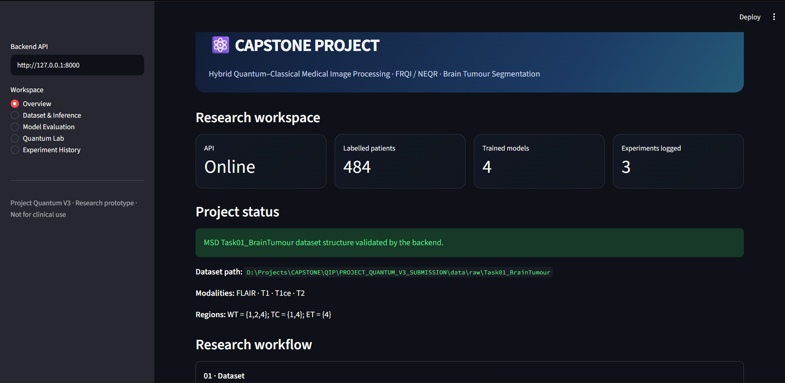
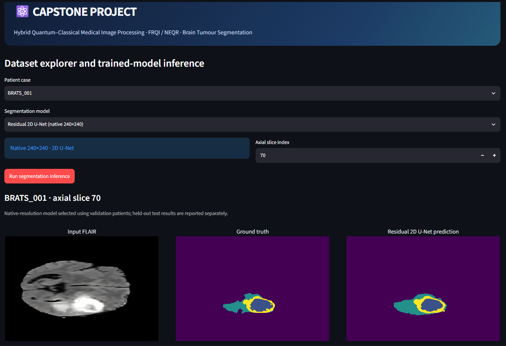
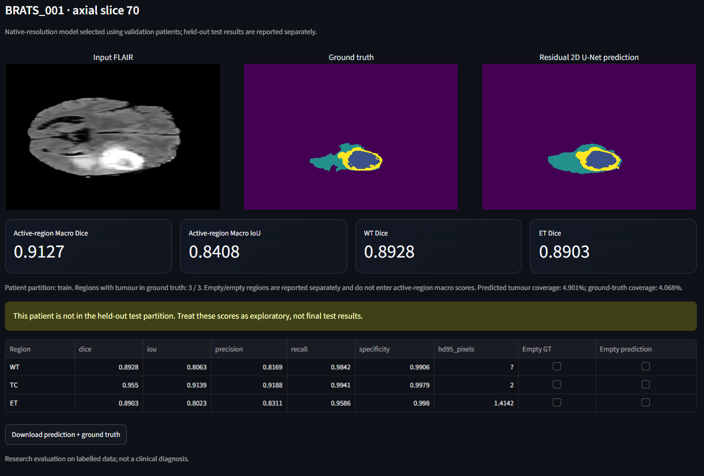
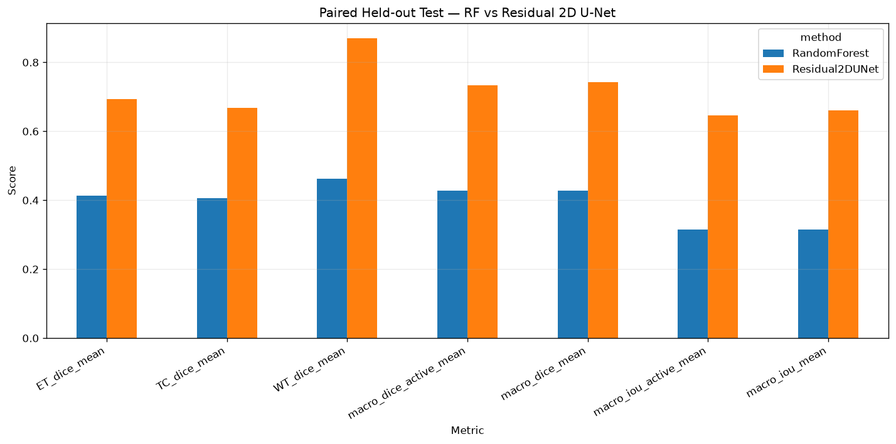
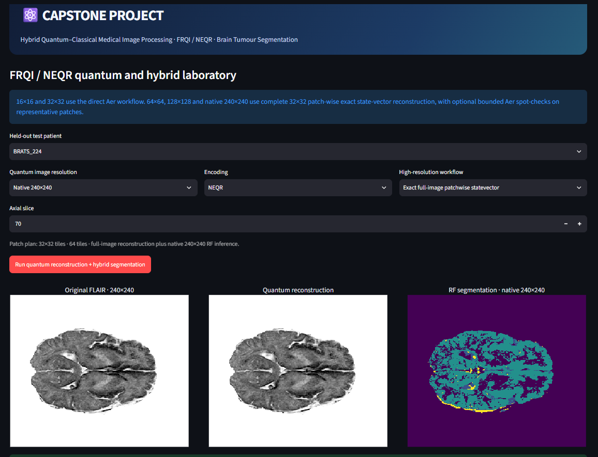
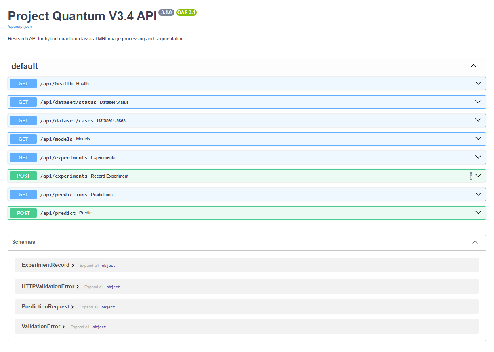
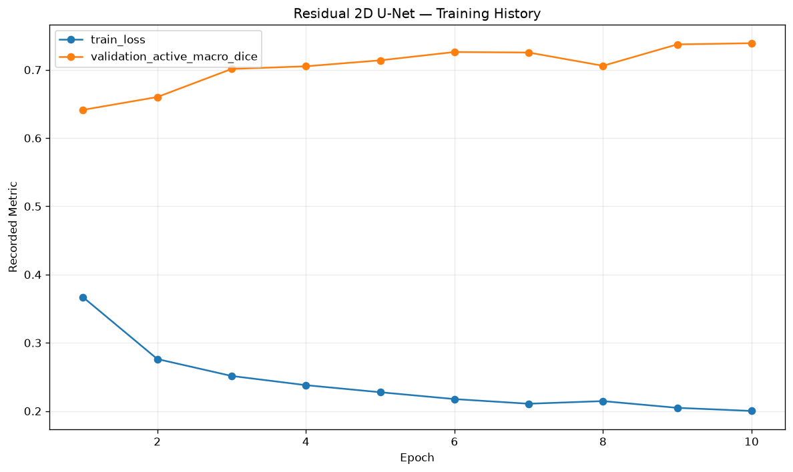
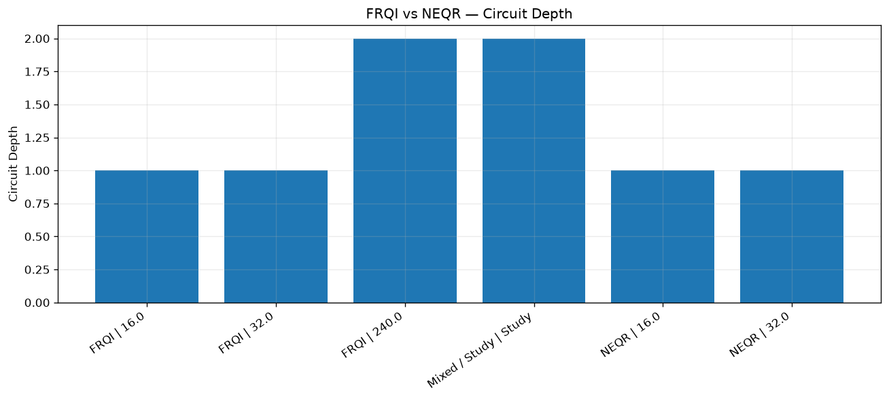

# Project Quantum V3.4

### Hybrid Quantum–Classical Medical Image Processing for Brain Tumour Segmentation

**FRQI · NEQR · Random Forest · Residual 2D U-Net · FastAPI · Streamlit**

> Project Quantum V3.4 is a research prototype exploring quantum image representation and reconstruction alongside classical medical-image segmentation. FRQI and NEQR are investigated for FLAIR image encoding/reconstruction; segmentation is performed using classical Random Forest and Residual 2D U-Net models.

<!-- Add a genuine screenshot of the running application here. -->



---

## Contents

- [Project overview](#project-overview)
- [Research objectives](#research-objectives)
- [Application demonstration](#application-demonstration)
- [Methodology and architecture](#methodology-and-architecture)
- [Dataset and experimental protocol](#dataset-and-experimental-protocol)
- [Key results: paired RF vs U-Net](#key-results-paired-rf-vs-u-net)
- [U-Net training history](#u-net-training-history)
- [Random Forest resolution study](#random-forest-resolution-study)
- [FRQI and NEQR reconstruction study](#frqi-and-neqr-reconstruction-study)
- [Technology stack](#technology-stack)
- [Repository structure](#repository-structure)
- [Installation and execution](#installation-and-execution)
- [Reproducibility and limitations](#reproducibility-and-limitations)
- [Disclaimer](#disclaimer)

## Project overview

Project Quantum investigates a hybrid research workflow combining quantum image representation experiments with classical brain tumour segmentation. The work focuses on two complementary areas:

1. **Quantum image processing:** encode and reconstruct FLAIR image data using Flexible Representation of Quantum Images (FRQI) and Novel Enhanced Quantum Representation (NEQR), using Qiskit simulation workflows.
2. **Classical segmentation:** evaluate Random Forest (RF) models at multiple image resolutions and a native-resolution Residual 2D U-Net for tumour-region segmentation.

The project includes a local research application, a FastAPI backend, experiment/evaluation reports, saved model artifacts, notebooks, and automated tests.

## Research objectives

- Investigate FRQI and NEQR image representation/reconstruction workflows.
- Measure reconstruction fidelity and simulation/resource characteristics where recorded.
- Evaluate RF segmentation at **16×16**, **32×32**, and **240×240** resolutions.
- Evaluate a **Residual 2D U-Net** at native **240×240** resolution.
- Compare RF and U-Net using paired held-out test results on identical evaluation samples.
- Present quantum reconstruction and downstream classical segmentation as distinct experimental stages.

## Application demonstration

The following slots are reserved for genuine captures from the running application. Place images in `docs/images/`. Remove any placeholder whose screen or feature is not present in the released application.

### 1. Research workspace / application overview


### 2. Dataset explorer and segmentation inference



### 3. Example segmentation output



### 4. Paired held-out RF versus U-Net comparison



### 5. NEQR (240x240) quantum laboratory



### 6. Backend API documentation



## Methodology and architecture

### End-to-end workflow

```text
Medical Segmentation Decathlon — Task01_BrainTumour
                    │
                    ├── Dataset validation and patient-level split
                    │
                    ├── FLAIR image
                    │       ├── FRQI encoding / reconstruction experiments
                    │       └── NEQR encoding / reconstruction experiments
                    │
                    ├── Classical segmentation
                    │       ├── Random Forest: 16×16
                    │       ├── Random Forest: 32×32
                    │       ├── Random Forest: 240×240
                    │       └── Residual 2D U-Net: 240×240
                    │
                    └── Evaluation and research application
                            ├── Dice / IoU and region-wise reports
                            ├── Paired RF–U-Net held-out comparison
                            ├── Quantum reconstruction/resource reports
                            └── FastAPI backend + Streamlit frontend
```

### Segmentation regions

| Label | Meaning                              |
| ----: | ------------------------------------ |
|     0 | Background                           |
|     1 | Necrotic / non-enhancing tumour core |
|     2 | Oedema                               |
|     4 | Enhancing tumour                     |

- **Whole Tumour (WT):** labels `{1, 2, 4}`
- **Tumour Core (TC):** labels `{1, 4}`
- **Enhancing Tumour (ET):** label `{4}`

## Dataset and experimental protocol

- **Dataset:** Medical Segmentation Decathlon, Task01_BrainTumour.
- **Cases:** 484 labelled cases.
- **Modalities:** FLAIR, T1, T1ce, and T2.
- **Patient-level split:** 338 training / 72 validation / 74 held-out test cases.
- **Split seed:** 42.
- **In-plane image dimensions:** 240×240 slices.

The raw medical dataset is not included in this repository. Obtain it from its original distribution and configure the local data path as described in the installation documentation. Do not upload raw medical data or patient-identifying information to this repository.

## Key results: paired RF vs U-Net

The following values are transcribed from the project's paired held-out test comparison displayed in the application. Both model families are evaluated on the same held-out slices. Values are reported as means.

| Metric                     | Random Forest |  Residual 2D U-Net |
| -------------------------- | ------------: | -----------------: |
| Enhancing Tumour Dice (ET) |      0.414109 | **0.693023** |
| Tumour Core Dice (TC)      |      0.406219 | **0.667548** |
| Whole Tumour Dice (WT)     |      0.462928 | **0.869696** |
| Active-region Macro Dice   |      0.427752 | **0.732803** |
| Macro Dice                 |      0.427752 | **0.743423** |
| Active-region Macro IoU    |      0.314343 | **0.645767** |
| Macro IoU                  |      0.314343 | **0.660040** |

**Interpretation:** in this paired held-out evaluation, the Residual 2D U-Net has higher reported mean Dice and IoU values than the Random Forest baseline across the listed metrics. These results apply to this experimental setup and split; they should not be generalized beyond the evaluated data without further validation.


*The table contains the numeric result. The figure is a supporting visualization; retain the exact values in the table for readability and accessibility.*

## U-Net training history

The project records a 10-epoch training history for the Residual 2D U-Net. The supplied training plot shows decreasing training loss and an overall increase in validation active-region Macro Dice during training.



**Important:** training loss and validation Dice are different metrics. A plot that places them on one vertical axis is a visual summary only; their numerical magnitudes must not be compared directly. The held-out test results above—not the training curve—are the primary evidence for final model performance.

## FRQI and NEQR reconstruction study

FRQI and NEQR are evaluated as quantum image representation/reconstruction approaches. Their comparison should report reconstruction and resource metrics separately from segmentation metrics.

### Quantum experiment figures



## Technology stack

| Component                     | Technology                 |
| ----------------------------- | -------------------------- |
| Language                      | Python                     |
| API                           | FastAPI                    |
| Frontend                      | Streamlit                  |
| Classical baseline            | Scikit-learn Random Forest |
| Deep learning                 | PyTorch Residual 2D U-Net  |
| Quantum circuits / simulation | Qiskit and Qiskit Aer      |
| Data and experiment analysis  | NumPy, pandas, Matplotlib  |
| Testing                       | pytest                     |

## Repository structure

```text
PROJECT_QUANTUM_V3_SUBMISSION/
├── app/                       # Research frontend
├── artifacts/                 # Trained model artifacts and metadata
├── configs/                   # Project configuration
├── data/
│   ├── demo/                  # Synthetic/demo data
│   ├── raw/                   # Local dataset location; raw dataset excluded from Git
│   └── processed/             # Rebuildable local cache; excluded from Git
├── db/                        # Database files / schema
├── docs/                      # Documentation and README screenshots
│   └── images/                # Application and research figures
├── notebooks/                 # Research and analysis notebooks
├── outputs/
│   ├── reports/               # Evaluation and quantum experiment reports
│   └── figures/               # Generated research figures
├── scripts/                   # Utility and experiment scripts
├── src/                       # Core implementation
├── tests/                     # Automated tests
├── .env.example               # Example environment configuration
├── .gitignore
├── .gitattributes             # Git LFS rules
├── README.md
├── requirements.txt
├── requirements-quantum.txt
├── requirements-unet.txt
└── run_*.bat / setup_windows.bat
```

## Installation and execution

Commands below are intended for Windows PowerShell from the repository root.

### 1. Create and activate the environment

```powershell
python -m venv .venv
.\.venv\Scripts\Activate.ps1
```

### 2. Install dependencies

```powershell
python -m pip install --upgrade pip
pip install -r requirements.txt
```

Install the additional quantum and U-Net dependencies when required by the selected experiments:

```powershell
pip install -r requirements-quantum.txt
pip install -r requirements-unet.txt
```

### 3. Configure the dataset

Obtain the Medical Segmentation Decathlon Task01_BrainTumour dataset separately. Follow the project installation documentation and configure its local path. The raw dataset is intentionally excluded from Git.

### 4. Start the backend API

```powershell
.\run_api.bat
```

The local API is expected at `http://127.0.0.1:8000`; interactive API documentation is available at `http://127.0.0.1:8000/docs` when the server is running.

### 5. Start the frontend

In a separate PowerShell terminal:

```powershell
.\run_frontend.bat
```

The local Streamlit frontend is expected at `http://localhost:8501` when the application starts successfully.

### 6. Run tests

```powershell
.\run_tests.bat
```

Or run pytest directly:

```powershell
python -m pytest -q
```

## Reproducibility and limitations

- The reported classical split is patient-level: 338 training, 72 validation, and 74 held-out test cases, with seed 42.
- Validation data is used for model selection/calibration; the held-out test set is reserved for final evaluation.
- The RF/U-Net table above is based on the paired held-out comparison report. Use that paired report for direct model comparisons.
- FRQI/NEQR image reconstruction experiments use Qiskit simulation workflows. Simulator results are not physical quantum-computer experiments.
- The segmentation models are classical models. The U-Net is a 2D network; do not describe it as a 3D model or quantum neural network.
- No quantum speedup, quantum advantage, or computational advantage is claimed.
- HD95 values in current project reports are measured in **pixels**, not millimetres, unless a separate spacing-aware conversion is explicitly documented.
- Results depend on the dataset split, preprocessing, resolution, simulator configuration, and experiment settings. Report these alongside results.
- A sample inference for a training-partition patient is a qualitative demonstration, not held-out test performance.

## Disclaimer

**Research prototype — not for clinical use.** This software is intended for academic experimentation and research demonstration. It is not a medical device, does not provide a clinical diagnosis, and must not be used to make patient-care decisions.

---

## Dataset Details

This project uses the Medical Segmentation Decathlon (MSD), Task01_BrainTumour dataset.
Modalities: FLAIR, T1, T1ce and T2

- Format: NIfTI (.nii.gz)
- License: CC BY-SA 4.0

The experiments use 484 labelled patient cases, divided into 338 training, 72 validation and 74 held-out test cases using a patient-level split (seed 42).

The raw dataset is not included in this repository. Users must download it separately and place the extracted Task01_BrainTumour directory under data/raw/.

[Dataset Link(You will be redirected to Google Drive)](https://drive.google.com/file/d/1A2IU8Sgea1h3fYLpYtFb2v7NYdMjvEhU/view?usp=sharing)

---


<h1 align="center">THANK YOU</h1>
